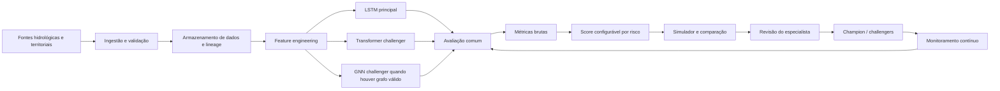

# Proposta revisada — Sistema de previsão de eventos hidrológicos

## 1. Visão geral

Esta proposta define um sistema de apoio à previsão de eventos hidrológicos, mantendo a **LSTM como modelo principal** e estruturando uma comparação controlada com modelos **Transformer** e **Graph Neural Network (GNN)**.

O sistema não deve escolher um modelo apenas por uma métrica isolada ou por uma demonstração pontual. A proposta é estabelecer um processo completo para:

1. preparar e validar os dados;
2. treinar a LSTM como referência principal;
3. comparar seu desempenho com Transformers e GNNs quando houver dados compatíveis;
4. simular diferentes cenários hidrológicos;
5. calcular uma pontuação configurável por administrador;
6. selecionar o modelo mais adequado para cada contexto;
7. acompanhar o desempenho depois da seleção;
8. manter o especialista responsável pela validação e pela decisão operacional.

O objetivo é transformar a escolha do modelo em um processo **mensurável, auditável, reproduzível e ajustável ao tipo de risco**, sem presumir antecipadamente que uma arquitetura será sempre superior às demais.

## 2. Objetivo do sistema

O sistema deverá produzir previsões para um horizonte e uma unidade de análise que ainda precisam ser definidos para cada caso de uso. A unidade poderá ser, por exemplo, um município, uma estação, uma bacia ou outro recorte territorial adotado pelo projeto.

A previsão poderá representar uma variável contínua — como nível, vazão ou volume —, uma probabilidade de ocorrência de evento, ou as duas formas simultaneamente. Essa definição deve ser formalizada antes do treinamento, porque determina os rótulos, as métricas e a forma de comparar os modelos.

O resultado esperado não é apenas uma previsão numérica. Cada execução deverá, quando os dados permitirem, apresentar:

- previsão para o horizonte definido;
- probabilidade ou classificação de evento;
- intervalo ou medida de incerteza;
- fatores e dados utilizados na previsão;
- versão do modelo;
- timestamp da execução;
- indicação de qualidade e atualidade dos dados;
- recomendação para avaliação humana.

O sistema deve apoiar a decisão, e não emitir automaticamente uma decisão institucional sem a validação do responsável autorizado.

## 3. Papel de cada família de modelos

### 3.1 LSTM como modelo principal

A LSTM será o modelo principal da primeira versão porque é adequada para explorar dependências temporais em séries hidrológicas. Ela deverá funcionar como referência operacional e metodológica do projeto.

A LSTM não deve ser considerada vencedora por definição. Seu papel inicial é fornecer:

- uma linha de base técnica consistente;
- um modelo conhecido para comparação;
- uma referência para avaliar ganhos ou perdas das arquiteturas alternativas;
- uma primeira versão que possa ser validada com os dados disponíveis.

### 3.2 Transformer como modelo desafiante

O Transformer será avaliado como alternativa para capturar dependências temporais de maior alcance e relações entre diferentes variáveis de entrada.

A comparação deverá ocorrer com o mesmo objetivo de previsão, os mesmos horizontes e a mesma divisão temporal dos dados. Caso o Transformer utilize informações adicionais, essa diferença deverá ser registrada para que o resultado não seja interpretado como uma superioridade da arquitetura quando, na realidade, decorre de um conjunto de entradas diferente.

### 3.3 GNN como modelo desafiante espacial-temporal

A GNN será considerada quando existir uma representação confiável das relações entre unidades territoriais, estações, rios, bacias ou outros pontos conectados. O grafo deverá ter significado operacional e ser documentado.

Sem uma estrutura espacial ou de conectividade suficientemente definida, a GNN não deverá ser incluída apenas por ser uma tecnologia mais sofisticada. Nesse caso, o sistema deverá registrar que a arquitetura não é aplicável ao cenário atual ou que depende de dados adicionais.

Quando for aplicável, a GNN poderá ser comparada como modelo espacial-temporal, preservando a mesma definição de evento e horizonte usada na LSTM e no Transformer.

## 4. Preparação dos dados e regras de comparação

A comparação entre modelos precisa ser justa antes de ser sofisticada. Para isso, o sistema deverá usar um protocolo comum.

### 4.1 Definição prévia do problema

Antes do treinamento, deverão ser registrados:

- variável ou evento a prever;
- unidade territorial ou operacional;
- horizonte de previsão;
- frequência dos dados;
- período histórico utilizado;
- regra para definir o evento observado;
- fontes de dados e sua proveniência;
- tratamento de dados faltantes, atrasados ou inconsistentes;
- critérios de exclusão e de qualidade;
- forma de atualização dos rótulos após o evento real.

Esses itens não devem ser escolhidos implicitamente durante a comparação, pois alterações na definição do problema podem produzir uma comparação inválida.

### 4.2 Separação temporal

Os dados deverão ser separados respeitando a ordem temporal. O conjunto de teste deve permanecer isolado até que as decisões de modelagem estejam concluídas.

Uma estratégia recomendada é utilizar:

- conjunto de treinamento para ajuste dos parâmetros;
- conjunto de validação para escolha de arquitetura e hiperparâmetros;
- conjunto de teste temporal, mantido congelado, para a avaliação final;
- janelas temporais móveis ou expansivas para verificar estabilidade ao longo do tempo.

Quando o domínio exigir generalização territorial, poderá ser acrescentada uma validação por região, estação, bacia ou município. Essa etapa deve ser usada apenas quando houver dados suficientes e uma unidade de generalização claramente definida.

### 4.3 Prevenção de vazamento de informação

O pipeline deverá impedir que dados disponíveis somente depois do instante da previsão sejam utilizados durante o treinamento. Transformações, normalizações, seleção de variáveis e engenharia de atributos devem ser ajustadas no conjunto de treinamento e aplicadas aos demais conjuntos sem incorporar informação futura.

O mesmo cuidado deve ser aplicado ao simulador e ao cálculo das métricas.

### 4.4 Condições equivalentes

Para cada rodada de comparação, o sistema deverá registrar se os modelos utilizaram:

- o mesmo conjunto de entradas;
- o mesmo período de treinamento;
- o mesmo horizonte;
- a mesma definição de evento;
- a mesma janela de previsão;
- o mesmo conjunto de teste;
- regras equivalentes para dados ausentes;
- restrições operacionais comparáveis.

Se uma condição for diferente, o relatório deverá explicitar a diferença e classificar o resultado como uma comparação controlada ou exploratória.

## 5. Como os modelos serão avaliados

A avaliação deverá combinar métricas de previsão, métricas de evento e critérios operacionais. A escolha definitiva das métricas dependerá do tipo de saída definido para o sistema.

### 5.1 Previsão de variáveis contínuas

Quando o modelo prever nível, vazão, volume ou outra variável contínua, poderão ser avaliados:

- erro absoluto médio (MAE);
- raiz do erro quadrático médio (RMSE);
- erro percentual ou relativo, quando matematicamente adequado;
- desempenho em picos e extremos;
- estabilidade do erro por período e por unidade territorial.

MAE e RMSE não devem ser usados isoladamente. O RMSE pode penalizar mais fortemente erros grandes, enquanto o MAE oferece uma leitura mais direta do erro médio. A escolha deve refletir o impacto dos erros no caso de uso.

### 5.2 Previsão de eventos

Quando o modelo indicar ocorrência ou não ocorrência de um evento, a avaliação poderá incluir:

- precisão;
- revocação ou sensibilidade;
- F1-score;
- área sob a curva Precision-Recall, especialmente em eventos raros;
- taxa de falsos alarmes;
- taxa de eventos não detectados;
- antecedência média da previsão;
- desempenho separado por tipo de risco e por região.

Em proteção e defesa civil, deixar de detectar um evento relevante pode ter um impacto diferente de gerar um falso alarme. Essa assimetria deverá ser refletida na avaliação e, quando apropriado, na configuração de pontuação.

### 5.3 Qualidade probabilística e calibração

Se o modelo produzir probabilidades, também deverá ser avaliado se elas são calibradas. Uma probabilidade de 80%, por exemplo, deve corresponder aproximadamente à frequência observada em situações equivalentes ao longo de muitas previsões.

Podem ser considerados:

- Brier Score;
- curvas de calibração;
- confiabilidade por faixa de probabilidade;
- comportamento de abstention ou baixa confiança, quando implementado.

Uma previsão com boa classificação, mas probabilidade mal calibrada, pode prejudicar a priorização operacional. Por isso, a calibração deve ser avaliada separadamente da capacidade de discriminação.

### 5.4 Critérios operacionais

Além da qualidade estatística, o sistema poderá acompanhar:

- tempo de inferência;
- disponibilidade do pipeline;
- taxa de falha da execução;
- custo computacional;
- estabilidade entre diferentes períodos;
- cobertura de unidades e situações avaliáveis;
- comportamento sob dados faltantes ou atrasados.

Esses critérios não substituem a qualidade preditiva, mas ajudam a evitar a seleção de um modelo que tenha bom resultado no teste e seja inadequado para a operação.

## 6. Score configurável pelo administrador

O sistema deverá oferecer uma funcionalidade para que o administrador configure os critérios usados na pontuação dos modelos e, quando necessário, defina regras específicas por tipo de risco.

Essa configuração não deve alterar os resultados brutos das métricas. Ela deverá controlar como os resultados são combinados para apoiar a comparação e a tomada de decisão.

### 6.1 Separação entre métricas e score

O sistema deverá preservar três níveis distintos:

1. **Métricas brutas:** resultados calculados diretamente a partir das previsões e dos valores observados.
2. **Score de avaliação do modelo:** combinação configurável das métricas para comparar candidatos.
3. **Prioridade ou classificação operacional:** resultado usado para apoiar a análise de um evento ou município.

Essa separação é importante para que uma alteração nos pesos do score não apague nem reescreva os resultados originais.

### 6.2 Configuração geral

O administrador poderá definir, conforme as regras autorizadas do projeto:

- métricas consideradas;
- peso de cada métrica;
- direção da métrica — quanto maior, melhor ou quanto menor, melhor;
- método de normalização para colocar métricas em uma escala comparável;
- critérios mínimos ou gates de aprovação;
- penalidades para falsos alarmes, eventos não detectados, baixa calibração, indisponibilidade ou latência;
- período e conjunto de dados aos quais a configuração se aplica;
- horizonte de previsão;
- vigência da configuração;
- justificativa da alteração.

Os valores dos pesos, limites e penalidades não são definidos nesta proposta. Eles devem ser aprovados pelo responsável pelo domínio e registrados com sua versão.

### 6.3 Configuração específica por tipo de risco

O administrador poderá criar uma configuração própria para cada tipo de risco cadastrado. Isso permite reconhecer que diferentes riscos podem ter prioridades distintas.

Por exemplo, uma configuração poderá dar maior peso à detecção de eventos e à antecedência, enquanto outra poderá valorizar mais a precisão da variável contínua ou a redução de falsos alarmes. O sistema não deverá impor esses pesos automaticamente; deverá permitir que sejam definidos, justificados e revisados por quem possui autoridade técnica para isso.

A configuração deverá indicar claramente:

- tipo de risco ao qual se aplica;
- região ou unidade territorial, se houver escopo específico;
- horizonte de previsão;
- métricas, pesos e gates;
- modelo ou modelos avaliados;
- versão e data de vigência;
- responsável pela aprovação.

Se não existir uma configuração específica, o sistema poderá utilizar uma configuração geral previamente aprovada, desde que essa regra seja explícita no relatório.

### 6.4 Exemplo conceitual de cálculo

O score poderá ser representado conceitualmente por:

```text
Score(modelo, tipo_de_risco) =
  soma dos resultados normalizados das métricas × seus pesos
  − penalidades configuradas
```

O sistema deverá preservar os componentes do cálculo. Assim, o usuário poderá compreender se um modelo obteve uma boa pontuação por apresentar menor erro, maior antecedência, melhor calibração ou menor taxa de falsos alarmes.

### 6.5 Governança da configuração

A tela administrativa deverá permitir:

- criar uma nova configuração;
- duplicar uma configuração existente para revisão;
- visualizar o efeito da configuração sobre avaliações já executadas;
- comparar versões de score;
- validar se os pesos e critérios são consistentes;
- submeter a configuração para aprovação;
- publicar uma versão com vigência definida;
- consultar o histórico;
- reverter para uma versão aprovada anterior.

Toda alteração deverá gerar um registro de auditoria com usuário, data, justificativa, valores anteriores e novos valores. A alteração do score não deverá mudar retroativamente os resultados publicados sem que isso seja identificado como uma reavaliação.

## 7. Simulador de cenários

O simulador será o ambiente para testar modelos e regras antes de uma possível utilização operacional. Ele deverá executar os modelos sob as mesmas condições e permitir comparar os resultados de forma controlada.

### 7.1 Tipos de cenário

O simulador poderá trabalhar com cenários derivados de:

- reprodução de períodos históricos;
- combinação de dados observados em uma janela selecionada;
- perturbações controladas em variáveis de entrada;
- atraso ou ausência simulada de dados;
- situações de intensidade ou persistência definidas pelo usuário;
- cenários de estresse para avaliar robustez.

Os tipos exatos de cenário, as variáveis que podem ser alteradas e os limites permitidos ainda devem ser definidos junto ao especialista. O simulador não deve gerar cenários que sejam apresentados como observações reais sem identificá-los claramente como simulados.

### 7.2 Parâmetros da execução

Cada execução deverá registrar:

- identificação do cenário;
- período e unidade territorial;
- tipo de risco;
- horizonte de previsão;
- conjunto de entradas;
- transformações aplicadas;
- modelos participantes;
- versão do score utilizada;
- usuário responsável;
- data e hora;
- resultado da execução.

O usuário deverá poder salvar e repetir um cenário. Isso permite comparar versões de modelos e de score sem depender de uma execução manual não reproduzível.

### 7.3 Resultado apresentado

Para cada modelo, o simulador deverá apresentar:

- trajetória ou classificação prevista;
- probabilidade e incerteza, quando disponíveis;
- valores observados, quando o cenário for histórico;
- métricas calculadas;
- score composto;
- componentes que formaram o score;
- divergências entre os modelos;
- indicação de aprovação, atenção ou reprovação nos gates;
- limitações e ausência de dados relevantes.

O resultado deverá permitir visualizar a LSTM como modelo principal e os Transformers e GNNs como alternativas comparáveis. A GNN somente deverá aparecer em cenários nos quais exista uma estrutura espacial compatível com seu treinamento.

### 7.4 Segurança operacional

O simulador deverá operar em modo de análise. Sua execução não deverá publicar alertas institucionais nem alterar automaticamente a configuração operacional. Qualquer promoção de modelo ou regra deverá passar pelo fluxo de aprovação definido pelo projeto.

## 8. Seleção do melhor modelo

O melhor modelo não será necessariamente aquele com a maior média global. A seleção deverá seguir uma sequência de gates e critérios.

### Etapa 1 — Validade da avaliação

O modelo somente poderá ser considerado se a execução tiver dados suficientes, divisão temporal válida, ausência de vazamento conhecido e métricas calculadas de forma consistente.

### Etapa 2 — Gates mínimos

O modelo deverá atender aos limites mínimos definidos para o caso de uso, como qualidade preditiva, calibração, taxa de eventos não detectados, estabilidade e tempo de inferência. Esses limites deverão ser configuráveis e aprovados pelo responsável técnico.

### Etapa 3 — Score por contexto

Entre os modelos aprovados nos gates, o sistema deverá calcular o score geral ou específico do tipo de risco, região e horizonte. O relatório deverá mostrar o score total e sua composição.

### Etapa 4 — Robustez

O resultado deverá ser comparado entre períodos, regiões e cenários relevantes. Um modelo que vence somente em uma janela e perde de forma consistente nas demais não deverá ser promovido sem uma justificativa explícita.

### Etapa 5 — Revisão humana

A recomendação automática deverá ser submetida ao especialista. O responsável poderá aprovar, rejeitar ou solicitar reavaliação, registrando a justificativa.

### Etapa 6 — Registro do modelo

O modelo selecionado deverá ser registrado como **champion** para o contexto definido. Os demais poderão permanecer como **challengers**, executados em comparação ou em modo sombra quando essa estratégia for aprovada.

A decisão deverá registrar o modelo escolhido, as alternativas avaliadas, o período, o conjunto de dados, a configuração do score, os gates, o responsável e a justificativa.

## 9. Acompanhamento do desempenho ao longo do tempo

A escolha do modelo encerra uma avaliação, não o ciclo de vida. Depois da seleção, o sistema deverá acompanhar quatro dimensões.

### 9.1 Saúde dos dados

- disponibilidade das fontes;
- atraso das entradas;
- percentual de valores ausentes;
- alterações de faixa e distribuição;
- inconsistências de unidade ou localização;
- qualidade e proveniência dos dados.

### 9.2 Desempenho preditivo

Quando os valores observados estiverem disponíveis, o sistema deverá recalcular as métricas por janela e por contexto:

- erro de previsão;
- detecção de eventos;
- falsos alarmes;
- eventos não detectados;
- antecedência;
- calibração;
- desempenho por risco e por região.

### 9.3 Drift e mudança de contexto

O sistema deverá comparar a distribuição atual das entradas e dos resultados com a referência usada no treinamento. Mudanças relevantes poderão indicar drift de dados, mudança de regime hidrológico, alteração do comportamento das fontes ou perda de representatividade do treinamento.

A detecção de drift não deve, por si só, substituir uma avaliação de impacto. Ela deverá gerar uma indicação para investigação e eventual revalidação.

### 9.4 Desempenho operacional

Também deverão ser observados:

- tempo de processamento;
- falhas de inferência;
- disponibilidade;
- consumo de recursos;
- quantidade de execuções sem dados suficientes;
- estabilidade da versão implantada.

### 9.5 Reavaliação e troca de modelo

Quando um modelo deixar de atender aos gates, apresentar degradação relevante ou for superado por um challenger em avaliações consistentes, o sistema deverá abrir uma reavaliação. A troca não deverá ocorrer somente por uma oscilação isolada.

O processo deverá permitir:

1. identificar o motivo da reavaliação;
2. executar o conjunto de testes definido;
3. comparar champion e challengers;
4. recalcular o score na versão de critérios vigente;
5. solicitar decisão humana;
6. promover, manter ou retirar o modelo;
7. preservar a possibilidade de rollback.

## 10. Arquitetura funcional proposta



Os dados, previsões, métricas, scores, configurações, versões e decisões deverão possuir identificadores e timestamps para permitir auditoria.

## 11. Fluxo de uso recomendado

1. O administrador cadastra ou revisa a definição do evento, horizonte e tipo de risco.
2. O sistema valida as fontes e prepara o conjunto de dados.
3. A LSTM é treinada e avaliada como modelo principal.
4. Transformers são treinados sob o mesmo protocolo.
5. GNNs são avaliadas quando houver dados e grafo compatíveis.
6. O usuário executa cenários históricos ou simulados.
7. O sistema calcula métricas brutas e aplica a configuração de score vigente.
8. O relatório mostra gates, score, incerteza e diferenças entre os modelos.
9. O especialista aprova a promoção do modelo ou solicita reavaliação.
10. O modelo selecionado passa a ser acompanhado como champion.
11. Os challengers continuam disponíveis para comparação, quando aplicável.
12. O monitoramento abre uma nova avaliação quando houver degradação, drift ou mudança relevante no contexto.

## 12. Indicadores de sucesso da solução

A solução poderá ser acompanhada por indicadores técnicos e operacionais, sem limitar a avaliação a um único percentual:

- redução do erro de previsão em relação à linha de base definida;
- aumento da detecção de eventos relevantes;
- redução de falsos alarmes sem aumentar eventos não detectados além do limite aprovado;
- melhoria da calibração das probabilidades;
- antecedência média das previsões;
- estabilidade entre períodos e unidades territoriais;
- tempo de inferência dentro do limite operacional;
- percentual de avaliações reproduzíveis pelo simulador;
- percentual de alterações de score e modelo com trilha de auditoria completa;
- tempo necessário para identificar degradação e iniciar reavaliação.

Os valores-alvo e os períodos de medição deverão ser definidos pelo responsável pelo domínio. Esta proposta descreve os indicadores possíveis, mas não fixa metas que ainda não foram fornecidas.

## 13. Implementação demonstrativa no protótipo

Os próximos passos foram traduzidos em visões navegáveis do frontend, mantendo a separação entre proposta, dados de demonstração e futura operação real. O módulo `client/src/lib/model-governance.ts` concentra o catálogo demonstrativo usado pelas telas.

### 13.1 Contrato de validação

A visão **Contrato de validação** registra um primeiro protocolo demonstrativo para **Inundação urbana**, com variável-alvo **Nível / vazão**, unidade **Bacias e estações**, horizonte de **6 h**, frequência de **15 min** e divisão temporal `70% treino · 15% validação · 15% teste temporal`. A tela também apresenta as fontes e seus requisitos, além das métricas MAE, RMSE, recall de evento, falsos alarmes, antecedência média e calibração.

Esses valores estruturam o primeiro caso de análise no protótipo, mas permanecem sujeitos à aprovação técnica e não representam uma configuração operacional publicada.

### 13.2 Simulador de cenários

A visão **Simulador** permite escolher cenários históricos, de estresse e de resiliência a fonte atrasada, além do modelo LSTM Hidro, Transformer ou GNN Bacias. A execução altera apenas o estado local da interface e apresenta score, recall, antecedência e calibração demonstrativos. A própria tela informa que o resultado não publica alertas, não altera o champion e não modifica o score vigente.

### 13.3 Comparação e seleção

A visão **Comparar modelos** apresenta a LSTM Hidro como modelo principal e Transformer/GNN Bacias como challengers. O protótipo mostra métricas comuns, score composto, prontidão e três gates: validade da avaliação, gates mínimos e robustez temporal. O usuário pode selecionar um candidato e enviar a recomendação para revisão humana, sem promover um modelo de forma automática.

### 13.4 Monitoramento pós-seleção

A visão **Monitoramento** apresenta score do champion, saúde das fontes, drift de entrada, tempo desde a revisão, série de score por janelas e sinais de investigação. O registro diferencia champion e challengers, com estados demonstrativos como saudável, em análise e dados insuficientes. A ação de abrir reavaliação é local e representa o início do fluxo de investigação.

### 13.5 Governança do score

A visão **Governança de score** permite alternar entre perfis demonstrativos de Inundação urbana, Cheia fluvial e Movimento de massa, ajustar pesos por slider e visualizar a soma dos critérios. A tela preserva a distinção entre métricas brutas e score composto e apresenta o fluxo Administrador → Revisor técnico → Especialista do domínio → Administrador/publicação.

O salvamento do rascunho e a troca de perfil ainda não persistem dados. A implementação real deverá acrescentar autenticação, autorização por perfil, validação dos pesos, versionamento, vigência, justificativa, auditoria, aprovação e possibilidade de rollback.

## 14. Informações que precisam ser definidas antes da implementação

Para transformar a proposta em especificação executável, será necessário confirmar:

- quais eventos serão previstos;
- qual variável será prevista e qual será o rótulo do evento;
- quais tipos de risco terão configurações próprias;
- qual unidade territorial será utilizada;
- quais fontes de dados estarão disponíveis;
- qual será o horizonte e a frequência das previsões;
- quais períodos históricos e critérios de qualidade serão adotados;
- quais métricas são obrigatórias;
- quais gates mínimos serão aplicados;
- quais perfis poderão alterar ou aprovar o score;
- quais limites operacionais de latência e disponibilidade serão aceitos;
- quais cenários o simulador poderá alterar;
- como os valores observados serão recebidos após cada previsão;
- quais ações exigem aprovação institucional;
- qual será a estratégia de implantação, modo sombra e rollback.

As definições acima continuam necessárias para transformar o baseline demonstrativo em especificação executável e aprovada. O protótipo agora oferece telas para registrar e discutir esses itens, mas os valores apresentados ainda não devem ser tratados como configuração operacional.

Essas definições devem ser registradas antes da comparação final dos modelos. Assim, a LSTM permanece como referência principal, mas a seleção de Transformer ou GNN poderá ocorrer de forma transparente quando houver evidência consistente de que a alternativa atende melhor aos critérios técnicos e operacionais do contexto avaliado.
